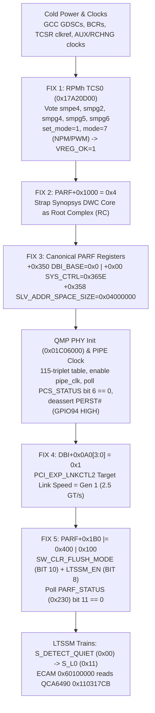

# Samsung Galaxy S23 (`dm1q` / SM8550) — PCIe0 & QCA6490 Wi-Fi Bring-Up Fixes

> **Target Platform:** Samsung Galaxy S23 (`dm1q` / `SM-S911B`) — Qualcomm Snapdragon 8 Gen 2 (`SM8550-AC` / Kalama)  
> **OS Target:** Native Windows 11 ARM64  
> **Wi-Fi Module:** Qualcomm QCA6490 / WCN6856 (FastConnect 6900, `PCI\VEN_17CB&DEV_1103`) on PCIe Root Complex 0 (`0x01C00000`)  
> **Implementation:** [`s23_wifi_pcie_fix.c`](./s23_wifi_pcie_fix.c)

---

## Overview & Failure Symptom

During native Windows 11 ARM64 bring-up of the QCA6490 Wi-Fi module on PCIe0, the host Root Complex came up far enough to lock the QMP PHY (`PCS_STATUS` `0x01C06214` bit 6 cleared, `gcc_pcie_0_pipe_clk` unhalted) and respond to DBI reads (`0x60000000` Vendor/Device ID `0x011317CB`). However, after releasing `PERST#` (`GPIO94`) and asserting `LTSSM_EN`, link training never started:

```text
PARF_LTSSM  (0x01C001B0) = 0x00000100   (LTSSM_EN=1, state=0x00 S_DETECT_QUIET, seen_states=0x00000001)
PARF_STATUS (0x01C00230) = 0x00000B00   (FLUSH_COMPLETED=1 [bit 8], FLUSH_MODE=1 [bit 11])
DBI_LNKSTA  (0x60000080) = 0x10110008   (DLLLA [bit 29] = 0)
DBI_DBG1    (0x6000072C) = 0x08200000   (no link-up or training transition)
ELBI_STTS   (0x60000F28) = 0x00000001   (XMLH_LINK_UP [bit 10] = 0)
SPMI smpg5  (PPID 0x6A7) = st=0x47      (VREG_OK [bit 7] = 0, en=0x80, mode=0x03 Retention, 966 mV)
```

A register-by-register hardware audit comparing our live kernel probe against the Qualcomm Linux driver (`pci-msm.c`) and SM8550 UEFI bring-up (`G289Pkg`) uncovered **five critical defects** preventing the LTSSM from leaving `S_DETECT_QUIET (0x00)` and enumerating the QCA6490 endpoint (`0x110317CB`).

---

## Summary of the 5 Root Causes & Fixes

| # | Subsystem | Register / Resource | Buggy State Observed | Required Fix | Failure Mechanism |
|---|---|---|---|---|---|
| **1** | PMIC / RPMh VRM | `smpe4`, `smpg2`, `smpg4`, `smpg5`, `smpg6` via `APPS_RSC` TCS0 (`0x17A20D00`) | Voted with `set_mode=0`; rails left in Retention (`mode=0x03`), `smpg5` stuck at `STATUS1=0x47` (`VREG_OK=0`) | Vote `set_mode=1` and `mode=7` (NPM/PWM) at `vrm_base+0x08` alongside voltage (`+0x00`) and enable (`+0x04`) | QCA6490 rails starved of active load current; `VREG_OK=0` prevents clean endpoint boot & PCIe RX termination |
| **2** | PCIe0 PARF | `PARF+0x1000` (`PARF_DEVICE_TYPE`) | Written as `0x0` (Endpoint) | Write `0x4` (Root Complex / Root Port) before PHY programming | Straps Synopsys DWC core as an Endpoint; two back-to-back Endpoints can never train a PCIe link |
| **3** | PCIe0 PARF | `PARF+0x00`, `PARF+0x350`, `PARF+0x358` | Non-canonical / overwritten PARF values (POR `SYS_CTRL=0x2000361C`, corrupted DBI/slave window) | Write canonical `0x365E` to `+0x00`, `0x0` to `+0x350`, and `0x04000000` to `+0x358` | Enables core/AXI clock auto-gating while idle, misroutes internal DBI decoding, or truncates the 64 MiB outbound aperture |
| **4** | PCIe0 DBI | `DBI+0x0A0` (`PCI_EXP_LNKCTL2[3:0]`) | Set to `0x2` (Gen 2 / 5.0 GT/s) prior to initial training | RMW bits `[3:0]` to `0x1` (Gen 1 / 2.5 GT/s) before LTSSM enable | Violates PCIe Base Spec initial negotiation sequence (must train to `L0` at Gen 1 before `Recovery.Speed` up-training) |
| **5** | PCIe0 PARF | `PARF+0x1B0` (`PARF_LTSSM`) & `PARF+0x230` (`PARF_STATUS`) | `PARF_STATUS=0x00000B00` (`FLUSH_MODE` bit 11 + `FLUSH_COMPLETED` bit 8 latched); only `LTSSM_EN` (`0x100`) written | Write `BIT(10)` (`SW_CLR_FLUSH_MODE=0x400`) alongside `LTSSM_EN` (`0x100`) to `PARF+0x1B0` | PARF holds the DWC Sub-MAC in flush reset; `LTSSM_EN` alone cannot advance state past `0x00` (`S_DETECT_QUIET`) |

---

## Hardware Architecture & Fix Sequencing

The diagram below shows where each of the 5 fixes in `Configure_S23_PCIe0_QCA6490()` executes relative to the full SM8550 PCIe0 bring-up pipeline:



> [!IMPORTANT]
> On SM8550, **no DBI (`0x60000000`) access is safe until QMP PHY initialization, `gcc_pcie_0_pipe_clk` enable, and `PCS_STATUS` (`0x01C06214` bit 6 == 0) have completed.** Attempting to access `dbi` before the PIPE clock is running triggers an immediate synchronous AXI External Abort (SError). In a full cold-boot driver, Fixes 1–3 execute before PHY programming and Fixes 4–5 execute after PHY/PIPE ready and `PERST#` release.

---

## Detailed Root-Cause Analysis

### 1. PMIC SMPS Rails Stuck in Ultra-Low-Power Retention Mode

#### Root Cause
The QCA6490 on Samsung Galaxy S23 (`dm1q`) is powered by five PM8550VS FTSMPS525 switching regulators (`type=0x1C, sub=0x11`) managed via Qualcomm's RPMh Voltage Regulator Manager (VRM). Each VRM resource in `CMD_DB` (`0x81C60000`) exposes three 32-bit control offsets:

| VRM Offset | Function | Value |
|---|---|---|
| `+0x00` | `VRM_VOLTAGE` | Output voltage in millivolts (`mV`) |
| `+0x04` | `VRM_ENABLE` | `0` = disable, `1` = enable |
| `+0x08` | `VRM_MODE` | `3` = Retention, `4` = LPM/PFM, `6` = AUTO, **`7` = NPM/PWM active HPM** |

In the live probe (`v1.0.0.7`), the Wi-Fi SMPS rails were voted with `set_mode=0`, which issued only `+0x00` (`VRM_VOLTAGE`) and `+0x04` (`VRM_ENABLE`) while skipping `+0x08` (`VRM_MODE`). Without an active mode vote, the VRM left the PMIC hardware `MODE_CTL` (`+0x45`) in its default **Retention mode (`0x03`)**.

Live SPMI post-vote telemetry exposed the exact failure on `smpg5` (`PPID 0x6A7`, `vdd-wlan`):

```text
PPID=0x4A4 (smpe4, vdd-wlan-dig)  : st=0x8F en=0x80 mode=0x03 v=966mV   <-- still in Retention (0x03)
PPID=0x69E (smpg2, vdd-wlan-aon)  : st=0x8F en=0x80 mode=0x07 v=1012mV  <-- mode not voted by driver
PPID=0x6A4 (smpg4, vdd-wlan-rfa2) : st=0x87 en=0x80 mode=0x07 v=1350mV  <-- had mode=7 -> VREG_OK=1
PPID=0x6A7 (smpg5, vdd-wlan)      : st=0x47 en=0x80 mode=0x03 v=966mV   <-- VREG_OK BIT 7 = 0!
PPID=0x6AA (smpg6, vdd-wlan-rfa1) : st=0x8F en=0x80 mode=0x03 v=2000mV  <-- still in Retention (0x03)
```

#### Why It Prevented QCA6490 Enumeration
In PMIC5 FTSMPS `STATUS1` (`+0x08`), **Bit 7 (`0x80`) is `VREG_OK`**. A reading of `0x47` (`0100_0111b`) confirms the regulator was enabled (`en=0x80`) in ultra-low-current Retention mode (`mode=0x03`), **not** in regulated active PWM mode. Retention mode cannot source the transient current required by the QCA6490 digital core, internal PMU, and PCIe SerDes during `WLAN_EN` / `PERST#` startup, causing brownout or preventing the endpoint from asserting PCIe receiver termination (`RX_DETECT`).

#### Resolution in `s23_wifi_pcie_fix.c`
`Configure_S23_PCIe0_QCA6490()` dispatches ordered RPMh Active Mode Channel (AMC) writes over `APPS_RSC` DRV2 TCS0 (`tcs_base = 0x17A20D00`) for all five verified S23 `CMD_DB` VRM rails with **`set_mode = 1`** and **`mode = 7` (`VRM_MODE_NPM_PWM`)**:

| Rail | PMIC Rail | DT Supply | S23 `CMD_DB` Base | Voltage (`+0x00`) | Mode (`+0x08`) | Enable (`+0x04`) | Expected SPMI Status |
|---|---|---|---|---|---|---|---|
| `smpe4` | PM8550VS_E S4 | `vdd-wlan-dig` | `0x40200` | `966 mV` (`0x03C6`) | `0x7` (NPM/PWM) | `0x1` | `0x87` / `0x8F` (`VREG_OK=1`) |
| `smpg2` | PM8550VS_G S2 | `vdd-wlan-aon` | `0x40400` | `1012 mV` (`0x03F4`) | `0x7` (NPM/PWM) | `0x1` | `0x87` / `0x8F` (`VREG_OK=1`) |
| `smpg4` | PM8550VS_G S4 | `vdd-wlan-rfa2` | `0x40600` | `1350 mV` (`0x0546`) | `0x7` (NPM/PWM) | `0x1` | `0x87` / `0x8F` (`VREG_OK=1`) |
| `smpg5` | PM8550VS_G S5 | `vdd-wlan` | `0x44100` | `966 mV` (`0x03C6`) | `0x7` (NPM/PWM) | `0x1` | `0x87` / `0x8F` (`VREG_OK=1`) |
| `smpg6` | PM8550VS_G S6 | `vdd-wlan-rfa1` | `0x40700` | `1900 mV` (`0x076C`) | `0x7` (NPM/PWM) | `0x1` | `0x87` / `0x8F` (`VREG_OK=1`) |

Each AMC write follows Qualcomm's RSC v3 TCS0 protocol: wait for `TCS0_STATUS` (`+0x28`) idle, load `MSGID = 0x00010108` (`LEN=8 | RESP_REQ | WRITE`), `ADDR`, and `DATA` into slot 0, enable slot 0 (`+0x2C = 1`), execute the clean `AMC_TRIGGER=0 -> AMC_ENABLE=0 -> AMC_ENABLE=1 -> AMC_TRIGGER=1` edge sequence on `TCS0_CTRL` (`+0x24`), poll `RSC_DRV_IRQ_STATUS` (`+0x04`) bit 0, and restore original TCS0 registers afterward.

---

### 2. `PARF_DEVICE_TYPE` Configured as Endpoint (`0x0`) Instead of Root Complex (`0x4`)

#### Root Cause
`PARF+0x1000` (`PCIE20_PARF_DEVICE_TYPE`) drives the `device_type[3:0]` hardware strap into the Synopsys DesignWare PCIe IP core:

| Value | PCIe Core Role |
|---|---|
| `0x0` | **PCI Express Endpoint (EP)** *(buggy value previously written)* |
| `0x1` | Legacy PCI Express Endpoint |
| **`0x4`** | **Root Port of PCI Express Root Complex (RC)** *(required)* |
| `0x5` / `0x6` | Switch Upstream / Downstream Port |

Writing `0x0` to `PARF+0x1000` strapped the SM8550 host controller into **Endpoint mode**.

#### Why It Prevented QCA6490 Enumeration
PCIe links are strictly asymmetric (Root Port / Downstream Port to Endpoint / Upstream Port). When both the SM8550 PCIe0 core and the QCA6490 Wi-Fi chip operate as Endpoints:
- Neither device drives Root Complex link-initiation state transitions or Type-1 Root Bridge configuration headers.
- Downstream configuration TLPs (`CFG0` via iATU) and host-side training behavior are disabled.

#### Resolution in `s23_wifi_pcie_fix.c`
Write `0x4` to `PARF+0x1000` as the very first PARF operation, strictly before QMP PHY programming, matching Qualcomm `pci-msm.c` (`line 6088`) and UEFI `g289_rc0.c`:

```c
mmio_w32(parf, PARF_DEVICE_TYPE, 0x00000004U); /* PARF+0x1000 = 0x4 (Root Complex) */
```

---

### 3. Overwritten Canonical Qualcomm PARF Registers

#### Root Cause
Three foundational PARF configuration registers had been overwritten with non-canonical values rather than Qualcomm's validated SM8550 (`pci-msm.c` / `G289Pkg`) settings:

1. **`PARF+0x0350` (`PARF_DBI_BASE_ADDR`):** Must be **`0x0`** on SM8550 PARF v2.7+/v2.9 (not the physical `0x60000000` CPU address used on older Qualcomm SoCs). Writing a non-zero base misroutes internal AXI-to-DBI address decoding.
2. **`PARF+0x0000` (`PARF_SYS_CTRL`):** After BCR reset, live S23 silicon read `0x2000361C`, which leaves automatic core-clock gating enabled (`CORE_CLK_CGC_DIS` = 0) and L1 clock removal enabled (`L1_CLK_RMV_DIS` = 0). Restoring canonical **`0x0000365E`** configures:

| Bit | Mask | Field Name (`pcie-qcom.c`) | POR (`0x2000361C`) | Fixed (`0x0000365E`) | Purpose |
|---|---|---|---|---|---|
| `1` | `0x0002` | `L1_CLK_RMV_DIS` | `0` | **`1`** | Prevents clock removal during L1 transitions |
| `2` | `0x0004` | `L23_CLK_RMV_DIS` | `1` | **`1`** | Prevents clock removal during L2/L3 transitions |
| `3` | `0x0008` | *(POR system control bit)* | `1` | **`1`** | Preserved per canonical Qualcomm `0x365E` |
| `4` | `0x0010` | `AUX_PWR_DET` | `1` | **`1`** | Indicates auxiliary power present to DWC core |
| `6` | `0x0040` | `CORE_CLK_CGC_DIS` | `0` | **`1`** | Disables automatic DWC core-clock gating |
| `9` | `0x0200` | `SLV_ACLK_CGC_DIS` | `1` | **`1`** | Disables slave AXI clock auto-gating |
| `10` | `0x0400` | `MSTR_ACLK_CGC_DIS` | `1` | **`1`** | Disables master AXI clock auto-gating |
| `12` | `0x1000` | `SLV_WAKEUP_EN` | `1` | **`1`** | Enables AXI slave wakeup signaling |
| `13` | `0x2000` | `MST_WAKEUP_EN` | `1` | **`1`** | Enables AXI master wakeup signaling |
| `29` | `0x20000000` | *(POR upper bit)* | `1` | **`0`** | Cleared to match canonical `0x365E` |

3. **`PARF+0x0358` (`PARF_SLV_ADDR_SPACE_SIZE`):** Must be **`0x04000000` (64 MiB)** to match the SM8550 PCIe0 outbound slave aperture (`0x60000000..0x63FFFFFF`: DBI `0x60000000`, ECAM `0x60100000`, I/O `0x60200000`, and 61 MiB MEM32 BAR space `0x60300000..0x63FFFFFF`). Truncating or zeroing this register prevents outbound AXI transactions from reaching the DesignWare core and iATU windows.

#### Resolution in `s23_wifi_pcie_fix.c`
```c
mmio_w32(parf, PARF_DBI_BASE_ADDR,       0x00000000U); /* PARF+0x350 = 0x0 */
mmio_w32(parf, PARF_SYS_CTRL,            0x0000365EU); /* PARF+0x000 = 0x365E */
mmio_w32(parf, PARF_SLV_ADDR_SPACE_SIZE, 0x04000000U); /* PARF+0x358 = 64 MiB */
```

---

### 4. Target Link Speed Clamped to Gen 2 (`0x2`) Before Initial Link Training

#### Root Cause
In the Synopsys DWC PCI Express Capability block (`DBI+0x070`), `PCI_EXP_LNKCTL2` resides at **`DBI+0x0A0`**, with bits `[3:0]` encoding the **Target Link Speed (`TLS`)**:
- `0x1`: Gen 1 (2.5 GT/s)
- `0x2`: Gen 2 (5.0 GT/s)
- `0x3`: Gen 3 (8.0 GT/s)

Our earlier probe copied `qcom,target-link-speed = 2` directly into `DBI+0x0A0[3:0]` **before** enabling the LTSSM.

#### Why It Prevented QCA6490 Enumeration
Per the PCI Express Base Specification, every PCIe link must establish initial `Detect -> Polling -> Configuration -> L0` synchronization at **Gen 1 (2.5 GT/s)** using 8b/10b TS1/TS2 ordered sets. Only **after** the link reaches `L0` at Gen 1 may the Root Complex or Endpoint initiate an autonomous or directed speed change to Gen 2 (5.0 GT/s) through `Recovery.Speed`. Forcing `TLS = 0x2` before initial bring-up can prevent clean initial training convergence on QCA6490 / SM8550 (notice both UEFI `g289_rc0.c` and Android `MuChain.c` explicitly program `DBI+0x0A0[3:0] = 1` before asserting `LTSSM_EN`).

#### Resolution in `s23_wifi_pcie_fix.c`
Use a read-modify-write on `DBI+0x0A0` to set bits `[3:0]` to `0x1` (Gen 1) while preserving all upper control/status bits:

```c
mmio_rmw32(dbi, DBI_PCI_EXP_LNKCTL2, 0x0000000FU, 0x00000001U); /* DBI+0x0A0[3:0] = 0x1 (Gen 1) */
```

---

### 5. PARF Trapped in Flush Mode (`PARF_STATUS = 0x00000B00`)

#### Root Cause
Live register telemetry from the S23 probe revealed the smoking gun behind `LTSSM` remaining completely frozen at `0x00` (`seen_states = 0x00000001`):

```text
PARF_STATUS (0x01C00230) = 0x00000B00  (binary: 0000_1011_0000_0000)
```

Decoding `0x00000B00`:
- **Bit 8 (`0x0100`) — `FLUSH_COMPLETED = 1`:** PARF has finished draining all pending AXI/PCIe transactions.
- **Bit 11 (`0x0800`) — `FLUSH_MODE = 1`:** PARF is actively latched in **Flush Mode**.

#### Why It Prevented QCA6490 Enumeration
Qualcomm's PARF wrapper automatically latches `FLUSH_MODE` following link-down events, BCR reset pulses, or power-domain teardown so in-flight AXI bus traffic drains safely without deadlocking the NoC. **While `FLUSH_MODE` (bit 11) remains asserted, PARF holds the Synopsys DesignWare Sub-MAC in reset.**

Writing only `LTSSM_EN` (`BIT(8) = 0x100`) to `PARF+0x1B0` (`PARF_LTSSM`) has zero effect while the Sub-MAC is held in flush reset: `PARF_LTSSM` reads back `0x00000100`, the LTSSM never even attempts `S_DETECT_ACT (0x01)`, and `DBI+0x72C` (`DBG1`) stays flat at `0x08200000`.

#### Resolution in `s23_wifi_pcie_fix.c`
Per Qualcomm `pci-msm.c` (`lines 7399–7432`), software must explicitly release Flush Mode by setting **`SW_CLR_FLUSH_MODE` (`BIT(10) = 0x400`)** alongside **`LTSSM_EN` (`BIT(8) = 0x100`)** in `PARF+0x1B0`, then poll `PARF_STATUS` (`0x230`) until `FLUSH_MODE` (`BIT(11)`) deasserts:

```c
mmio_rmw32(parf, PARF_LTSSM, 0U, (1U << 10) | (1U << 8)); /* PARF+0x1B0 |= 0x400 | 0x100 */
```

Once `FLUSH_MODE` clears, the Sub-MAC exits reset and the LTSSM transitions out of `S_DETECT_QUIET (0x00)` through `S_DETECT_ACT (0x01)` → `S_POLL_ACTIVE (0x02)` → `S_CFG_*` → `S_L0 (0x11)`.

---

## Verification Checklist

After integrating `Configure_S23_PCIe0_QCA6490()` into the S23 PCIe0 bring-up driver (with QMP PHY init, `pipe_clk` ready, and `PERST#` deassertion in place), verify the following live hardware states:

| Check | Register / Interface | Expected Healthy Readback |
|---|---|---|
| **Wi-Fi SMPS Rails Active** | SPMI `PPID 0x4A4`, `0x69E`, `0x6A4`, `0x6A7`, `0x6AA` | `st = 0x87` or `0x8F` (`VREG_OK` bit 7 = `1`), `mode = 0x07` (NPM/PWM) |
| **Root Complex Strap** | `PARF + 0x1000` (`PARF_DEVICE_TYPE`) | `0x00000004` |
| **Canonical PARF** | `PARF + 0x00`, `+0x350`, `+0x358` | `0x0000365E`, `0x00000000`, `0x04000000` |
| **Gen 1 Initial Speed** | `DBI + 0x0A0` (`PCI_EXP_LNKCTL2`) | Bits `[3:0]` == `0x1` prior to training |
| **Flush Mode Cleared** | `PARF + 0x0230` (`PARF_STATUS`) | Bit 11 (`FLUSH_MODE`) == `0` |
| **LTSSM Trained to L0** | `PARF + 0x01B0` (`PARF_LTSSM`) | Bits `[5:0]` == `0x11` (`S_L0`) |
| **Data Link Layer Active** | `DBI + 0x080` (`LNKSTA`) & `ELBI + 0x08` (`SYS_STTS`) | `DBI+0x80` bit 29 (`DLLLA`) == `1`; `ELBI+0x08` bit 10 (`XMLH_LINK_UP`) == `1` |
| **QCA6490 Enumeration** | ECAM `0x60100000` (via iATU Slot 0 `CFG0`) | `0x110317CB` (`VEN_17CB&DEV_1103`, Qualcomm QCA6490 / WCN6856) |
